# Dolores AR

# Evidencias del desarrollo

## Ronda 0: Preparación del proyecto

Se creó el proyecto Flutter, se instalaron las dependencias necesarias y se verificó su configuración inicial.

### Proyecto creado

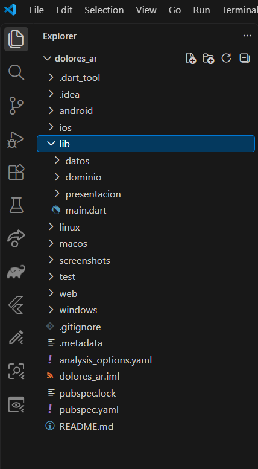

### Dependencias instaladas

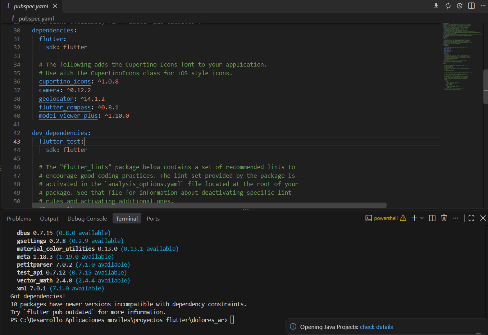

### Análisis del proyecto

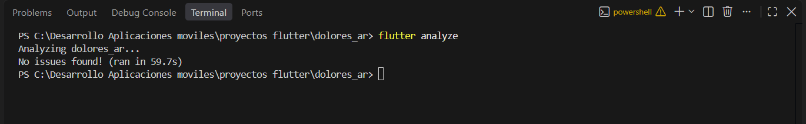

---

## Ronda 1: Cálculo de distancias con Haversine

### Fase ROJO

Se escribieron las pruebas antes de implementar las funciones.

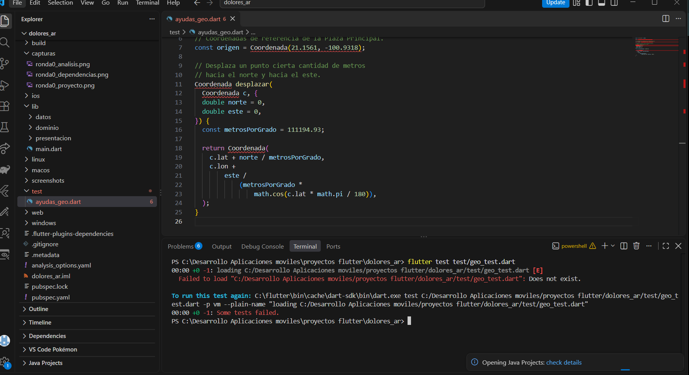

### Fase VERDE

Se implementó el cálculo de distancias y se verificó que las pruebas funcionaran correctamente.

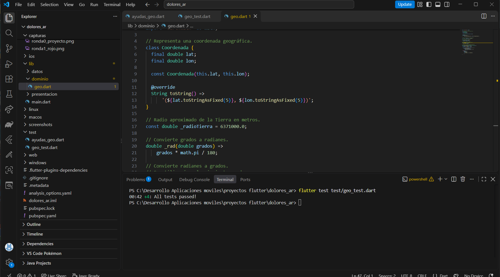

---

## Ronda 2: Rumbo y ángulos

### Fase ROJO

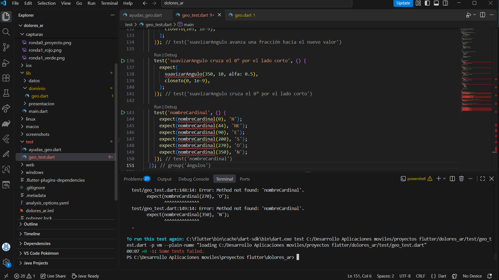

### Fase VERDE

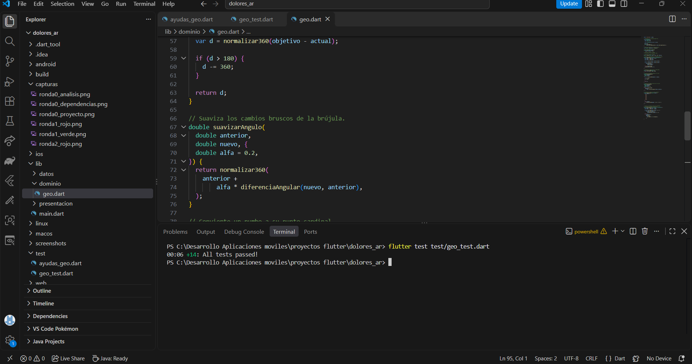

---

## Ronda 3: Campo de visión y catálogo turístico

### Fase ROJO

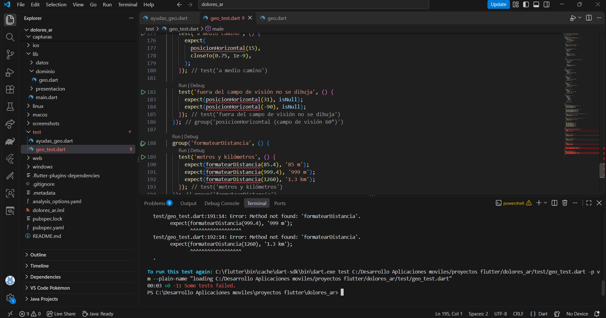

### Fase VERDE

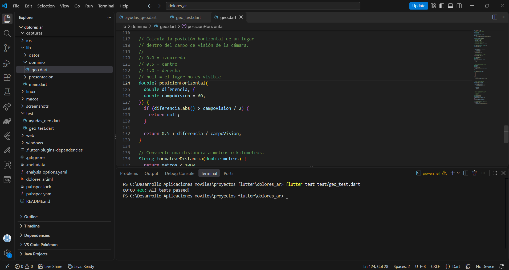

---

## Ronda 4: Motor de realidad aumentada

### Fase ROJO

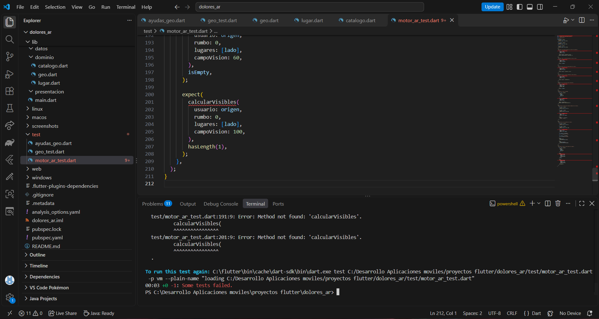

### Fase VERDE

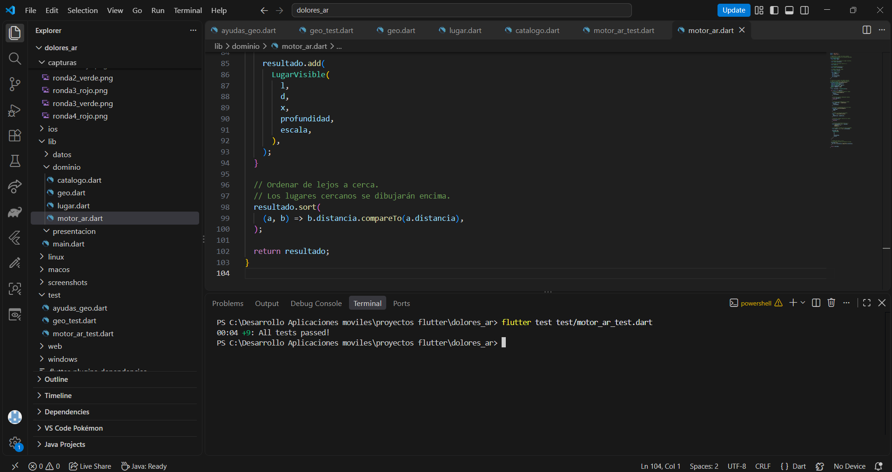

---

## Ronda 5: Pasaporte turístico

### Fase ROJO

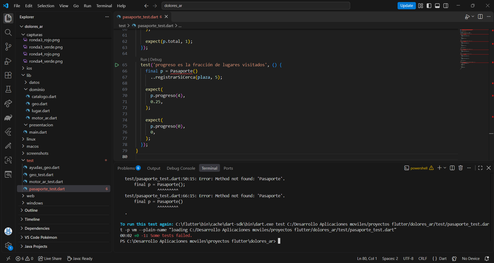

### Fase VERDE

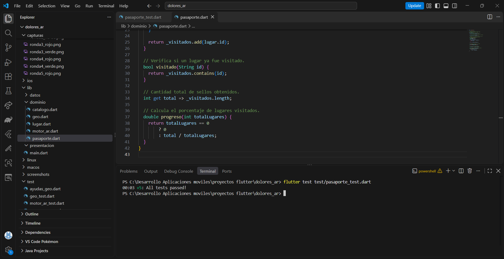

---

## Ronda 6: Fuentes de datos y ViewModel

### Fase ROJO

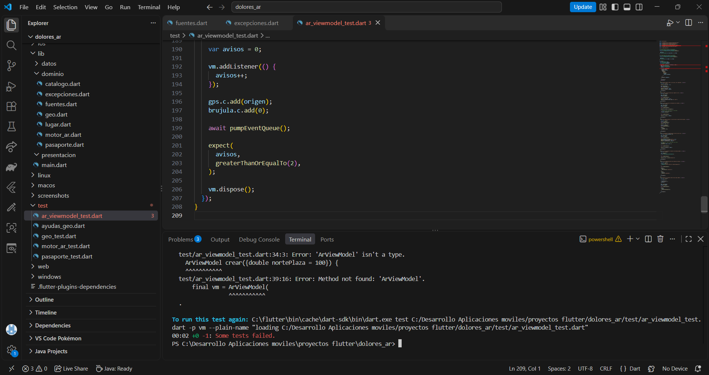

### Fase VERDE

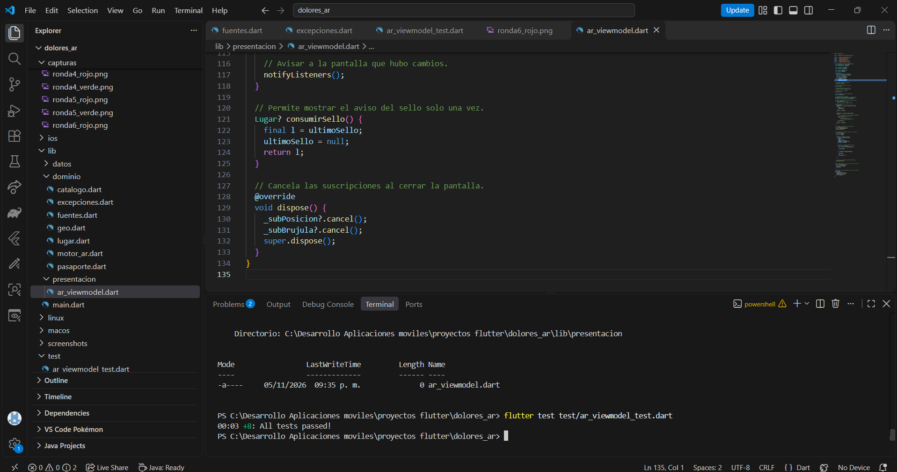

## Pruebas pendientes

- Ejecutar la aplicación en un teléfono físico con GPS, brújula y cámara.
- Visitar los lugares turísticos para verificar sus coordenadas.
- Actualizar los valores de `catalogo.dart` con las mediciones reales.
- Calibrar la brújula del dispositivo.
- Verificar que las etiquetas aparezcan sobre los lugares correspondientes.
- Agregar evidencias de las pruebas físicas al README.

**Nota:** Las evidencias incluidas en este README corresponden a las capturas disponibles de las rondas 0 a 6. Las capturas posteriores y las de calibración física se agregarán cuando estén disponibles.

